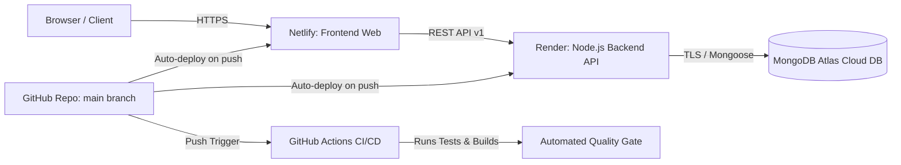

# BookBrain ERP — Netlify & Render Cloud Deployment Guide

This document provides step-by-step instructions to deploy BookBrain ERP into production:
- **Backend API**: Hosted on **Render** (Node.js Web Service)
- **Frontend Web**: Hosted on **Netlify** (Vite + React SPA)
- **Database**: **MongoDB Atlas**
- **CI/CD**: **GitHub Actions** (automated testing, build validation, and deployment triggers)

---

## 1. Architecture & Connection Overview

---

## 2. Deploy Backend on Render (Step-by-Step)

### Step 2.1: Log in to Render
1. Open [https://dashboard.render.com/](https://dashboard.render.com/) and sign in with your GitHub account.

### Step 2.2: Create New Web Service
1. Click **New +** -> **Web Service**.
2. Select **Build and deploy from a Git repository**.
3. Connect your repository: `vishalisrani7/BookBrainERP`.
4. Render will automatically detect `render.yaml` (Blueprint), or you can fill in manually:
   - **Name**: `bookbrain-api`
   - **Region**: Oregon (or closest to your users)
   - **Branch**: `main`
   - **Runtime**: `Node`
   - **Build Command**: `npm install && npm run build:api`
   - **Start Command**: `npm run start:api`
   - **Instance Type**: Free (or Starter for 24/7 uptime)

### Step 2.3: Set Environment Variables on Render
Under the **Environment Variables** tab, add:
| Key | Value | Notes |
| :--- | :--- | :--- |
| `NODE_ENV` | `production` | Enables production mode |
| `PORT` | `10000` | Render injects this automatically |
| `MONGODB_URI` | `mongodb+srv://<user>:<password>@cluster0.mongodb.net/bookbrain_erp?retryWrites=true&w=majority` | Your MongoDB Atlas connection string |
| `JWT_SECRET` | *(Click Generate or paste a secure 32+ char key)* | Secret for signing auth tokens |
| `CORS_ORIGIN` | `*` *(or your Netlify URL once deployed)* | Allows cross-origin API requests from Netlify |
| `ADMIN_INIT_USERNAME` | `admin` | Super Admin login username |
| `ADMIN_INIT_PASSWORD` | `BookBrainAdmin#2026` | Super Admin initial password |

### Step 2.4: Deploy and Note Down URL
1. Click **Create Web Service** / **Apply**.
2. Once deployed, Render will provide your public API URL, for example:
   `https://bookbrain-api.onrender.com`
3. Verify health in your browser:
   `https://bookbrain-api.onrender.com/health`
   Should return: `{"status":"healthy","system":"BookBrain WIP Inventory System",...}`.

---

## 3. Deploy Frontend on Netlify (Step-by-Step)

### Step 3.1: Log in to Netlify
1. Open [https://app.netlify.com/](https://app.netlify.com/) and sign in with GitHub.

### Step 3.2: Import from Git
1. Click **Add new site** -> **Import an existing project**.
2. Choose **GitHub** and select repository `vishalisrani7/BookBrainERP`.

### Step 3.3: Configure Build Settings
Netlify will automatically read `netlify.toml`, but verify:
- **Base directory**: *(Leave empty / root)*
- **Build command**: `npm run build:web`
- **Publish directory**: `apps/web/dist`

### Step 3.4: Add Environment Variable for Backend URL
In **Environment variables** (Site configuration -> Environment variables):
| Key | Value | Example |
| :--- | :--- | :--- |
| `VITE_API_URL` | Your Render API URL without trailing slash | `https://bookbrain-api.onrender.com` |

### Step 3.5: Deploy Site
1. Click **Deploy bookbrain-erp**.
2. Netlify builds the site and gives you a live URL, e.g. `https://bookbrain-erp.netlify.app`.
3. Open the link and log in with:
   - **Username**: `admin`
   - **Password**: `BookBrainAdmin#2026`

---

## 4. GitHub Actions CI/CD Pipeline

Every time you push code or merge a Pull Request into `main`:
1. **GitHub Actions** triggers automatically (`.github/workflows/ci-cd.yml`).
2. Checks out code and installs dependencies.
3. Compiles the `@bookbrain/shared` contracts.
4. Executes the complete 19-test automated backend test suite.
5. Verifies production builds of both Web (`apps/web`) and API (`apps/api`).
6. Both Render and Netlify receive the GitHub push webhook and automatically deploy the updated application with zero downtime.

---

## 5. Summary of Pre-configured Files

- [`.github/workflows/ci-cd.yml`](file:///v:/BookBrainERP/.github/workflows/ci-cd.yml): Continuous integration pipeline with automated testing.
- [`netlify.toml`](file:///v:/BookBrainERP/netlify.toml): Netlify build script, publish directory, and SPA redirect rules.
- [`apps/web/public/_redirects`](file:///v:/BookBrainERP/apps/web/public/_redirects): Direct Netlify SPA fallback rule.
- [`render.yaml`](file:///v:/BookBrainERP/render.yaml): Render Infrastructure-as-Code Blueprint for one-click API deployment.
- [`apps/web/src/services/api-client.ts`](file:///v:/BookBrainERP/apps/web/src/services/api-client.ts): Automatically detects `VITE_API_URL` in production while preserving local `/api/v1` in dev.
